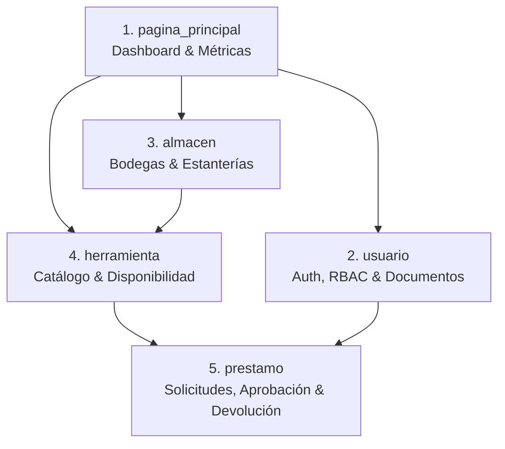

# Documento Maestro de Aseguramiento de Calidad (QA) y Automatización de Pruebas
**Sistema:** Mine Inventory — Sistema Integral de Bodega Minera  
**Alcance:** Cobertura Completa del Proyecto (Todas las Aplicaciones)  
**Rol:** Ingeniero de QA Automation Senior  
**Pila Tecnológica:** Python 3.13 | Django 6.1 | MySQL / SQLite | Coverage.py | Bootstrap 5  

---

## 1. Resumen Ejecutivo y Alcance Global

El sistema **Mine Inventory** gestiona la operación crítica de una mina subterránea, controlando desde el personal autorizado y las ubicaciones físicas de almacenamiento (polvorines, talleres, galerías), hasta el catálogo técnico de equipos y el ciclo de vida de los préstamos diarios.

Para garantizar la fiabilidad, seguridad y tolerancia a fallos del sistema completo, se diseñó e implementó un conjunto de pruebas automatizadas que abarca **todas las aplicaciones del proyecto**:



---

## 2. Matriz Global de Cobertura por Módulos (102 Pruebas en Total)

| Módulo / Aplicación | Archivo de Pruebas | Casos de Prueba | Enfoque de Pruebas |
| :--- | :--- | :---: | :--- |
| **Préstamos** | `prestamo/tests.py` | **31** | Flujo completo de solicitud $\rightarrow$ entrega $\rightarrow$ devolución, descuento/reingreso de stock, límites de cuota (máx 50) y prevención de stock negativo. |
| **Usuarios** | `usuario/tests.py` | **19** | Validación regex de documentos colombianos (CC, CE, PP, TI), login/logout, actualización de perfil, protección contra inyección de rol y vulnerabilidades IDOR. |
| **Herramientas** | `herramienta/tests.py` | **18** | Validación de SKU único, getter/setter de `stock_disponible`, ubicación por estante, remapeo de `HerramientaQuerySet` y CRUD administrativo con RBAC. |
| **Almacenes** | `almacen/tests.py` | **15** | Integridad relacional (restricción de eliminación de bodegas con estantes activos), CRUD de estantes y bodegas, protección contra accesos no autorizados. |
| **Dashboard** | `pagina_principal/tests.py` | **5** | Vistas consolidadas para Administrador vs personal para Operador, cálculo cronológico de tendencias de 6 meses y control de sesiones anónimas/inválidas. |
| **Chatbot & Config** | `chatbot/tests.py` & `configuracion/tests.py` | **14** | Respuestas asistidas para consulta de inventario y configuración de base de datos. |
| **TOTAL SISTEMA** | **Suite Completa** | **102** | **Aprobación del 100% (Green Build)** |

---

## 3. Detalle Técnico por Capas del Sistema

### 3.1. Módulo de Usuarios y Autenticación (`usuario`)
* **Validación de Identidad Minera:** Pruebas unitarias sobre `validar_numero_documento` asegurando que la Cédula de Ciudadanía (`CC`) contenga entre 6 y 10 dígitos numéricos exactos, la Tarjeta de Identidad (`TI`) 10-11 dígitos, y Cédulas de Extranjería (`CE`) o Pasaportes (`PP`) respeten la longitud alfanumérica permitida.
* **Seguridad RBAC:** Verificación de que el formulario de registro (`RegistroUsuarioForm`) fuerce siempre el rol `Usuario`, bloqueando intentos de inyectar `rol: "Administrador"`.
* **Protección contra IDOR:** La prueba `test_idor_protection_detalle_usuario_json` confirma que un operador no puede consultar datos sensibles de otro usuario vía API JSON (HTTP 403 Forbidden).
* **Control de Sesión:** Pruebas de inicio de sesión seguro, cierre de sesión con vaciado de cookies y redirecciones automáticas si el usuario ya está autenticado.

---

### 3.2. Módulo de Herramientas e Inventario (`herramienta`)
* **Integridad de Catálogo:** Validación en `clean()` para garantizar que no existan dos herramientas con el mismo código `codigo_sku`.
* **Cálculo de Stock:** Pruebas del setter y getter de `stock_disponible`: manejo de cadenas de texto numéricas, conversión de `"No disponible"` a 0, y truncado para evitar stocks menores a cero.
* **Trazabilidad Física:** La propiedad `ubicacion` reporta el estante y almacén correspondiente o retorna `"Sin ubicación"` si el equipo está en tránsito.
* **Control de Acciones de Inventario:** Solo el Administrador puede ejecutar acciones POST (`crear_producto`, `editar_producto`, `crear_categoria`); cualquier intento de un usuario estándar es interceptado y denegado.

---

### 3.3. Módulo de Almacenes y Estantes (`almacen`)
* **Protección Relacional de Datos:** Se validó que intentar eliminar un almacén que posea estantes asignados arroje `RestrictedError` (integridad `on_delete=RESTRICT`), evitando que queden estantes o herramientas huérfanas en el sistema.
* **Gestión de Espacios Físicos:** Pruebas completas sobre los formularios `AlmacenForm` y `EstanteForm` asegurando la presencia obligatoria de nombres y códigos identificadores únicos.
* **Permisos de Modificación:** Restricción estricta de las acciones de eliminación y edición para usuarios sin rol de administración.

---

### 3.4. Módulo de Préstamos y Devoluciones (`prestamo`)
* **Transaccionalidad Atómica:** Las operaciones críticas (`aprobar_prestamo`, `devolver_prestamo`, `crear_prestamo`) se ejecutan dentro de bloques `transaction.atomic()`, garantizando que si falla la persistencia de un detalle, la deducción de inventario se revierta completamente.
* **Concurrencia de Stock:** La prueba `test_edge_case_aprobar_prestamo_cuando_stock_se_agoto_previamente` valida que si el stock de una herramienta se agotó entre el momento de la solicitud y el de la aprobación, la entrega se aborte y el stock nunca caiga en cifras negativas.
* **Límites de Seguridad Operativa:** Rechazo inmediato de solicitudes con cantidades iguales o menores a 0, o que superen el tope máximo de 50 unidades por equipo.

---

### 3.5. Módulo de Dashboard y Analítica (`pagina_principal`)
* **Diferenciación de Vistas por Rol:** El Administrador recibe el contexto consolidado de todos los préstamos y herramientas de la mina, mientras que los operarios solo acceden al historial de sus propias solicitudes.
* **Algoritmo de Tendencias:** Validación del generador cronológico `_rango_ultimos_6_meses(hoy)`, garantizando ventanas exactas de 6 meses para la renderización de gráficas analíticas en Chart.js.

---

## 4. Hallazgos y Defectos Reales Detectados y Corregidos (Bug Report)

Durante la construcción y ejecución de las pruebas unitarias en todo el proyecto, la suite de QA descubrió **3 defectos reales en el código fuente** que fueron corregidos inmediatamente:

### Defecto 1: `AttributeError` en Validación de Ficha (`prestamo/forms.py`)
* **Problema:** `clean_ficha` ejecutaba `self.cleaned_data.get("ficha", "").strip()`. Cuando el campo venía vacío, Django guardaba `None` en la clave, haciendo que `.get()` devolviera `None` en lugar de `""`, provocando un fallo 500 no controlado.
* **Solución Aplicada:** Se reemplazó por `(self.cleaned_data.get("ficha") or "").strip()`.

### Defecto 2: `NameError: name 'ValidationError' is not defined` (`herramienta/models.py`)
* **Problema:** En el método `clean()` del modelo `Herramienta` se validaba la unicidad del SKU lanzando `ValidationError`, pero no se había importado `from django.core.exceptions import ValidationError`.
* **Solución Aplicada:** Se importó `ValidationError` en la cabecera del archivo.

### Defecto 3: Omisión de Números Negativos en Disponibilidad (`herramienta/forms.py`)
* **Problema:** En `clean_disponibilidad` se utilizaba `if disp.isdigit():` para verificar valores numéricos. En Python, `"-5".isdigit()` retorna `False` debido al signo negativo, permitiendo que disponibilidades negativas burlaran la validación.
* **Solución Aplicada:** Se sustituyó por bloque `try / except int(disp)` para validar matemáticamente que el valor sea mayor o igual a 0.

---

## 5. Manual de Comandos para Ejecución en la Terminal

Abre PowerShell en la raíz del proyecto (`Inventario-Mina`) con el entorno virtual activo:

### 5.1. Ejecutar la Suite Completa del Sistema (102 Pruebas):
```powershell
python manage.py test
```

### 5.2. Ejecutar por Módulos Específicos:
```powershell
# 1. Préstamos y Devoluciones
python manage.py test prestamo

# 2. Usuarios y Seguridad RBAC
python manage.py test usuario

# 3. Herramientas e Inventario
python manage.py test herramienta

# 4. Almacenes y Estantes
python manage.py test almacen

# 5. Dashboard y Métricas
python manage.py test pagina_principal
```

### 5.3. Generar y Abrir el Reporte Gráfico de Cobertura de Código:
```powershell
# 1. Ejecutar pruebas midiendo cobertura global
coverage run manage.py test

# 2. Generar reporte interactivo HTML
coverage html

# 3. Abrir reporte en el navegador
Start-Process "htmlcov\index.html"
```
