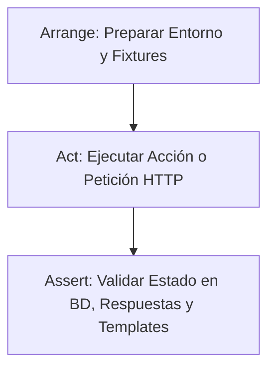
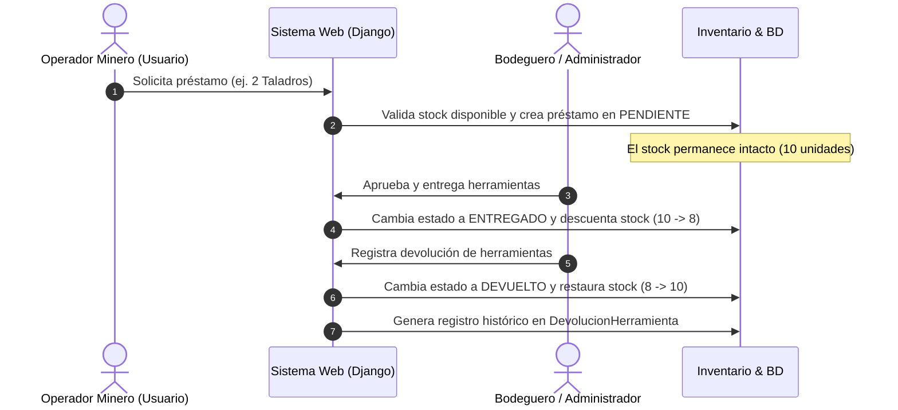

# Documento de Aseguramiento de Calidad (QA) y Automatización de Pruebas
**Sistema:** Mine Inventory — Sistema de Bodega Minera  
**Módulo Evaluado:** Gestión de Préstamos y Control de Herramientas (`prestamo`)  
**Autor:** Ingeniero de QA Automation Senior  
**Tecnologías:** Python 3.13 | Django 6.1 | SQLite / MySQL | Coverage.py  

---

## 1. Alcance y Contexto Técnico

El módulo de **Préstamos** es el núcleo operativo de la mina, encargado de gestionar la entrega, custodia y devolución de herramientas especializadas (taladros industriales, detectores de gas metano, lámparas mineras, etc.).

### Objetivos de la Suite de Pruebas:
1. **Garantizar la Integridad del Inventario:** Asegurar que el stock se descuente de manera atómica únicamente cuando un préstamo sea efectivamente aprobado y entregado, y se restituya sin inconsistencias al registrar la devolución.
2. **Control de Acceso Basado en Roles (RBAC):** Impedir que usuarios sin privilegios administrativos aprueben préstamos, registren devoluciones o accedan a datos privados de otros trabajadores.
3. **Robustez ante Casos Límite (Edge Cases):** Bloquear solicitudes de herramientas sin stock, cantidades superiores al límite de seguridad (máximo 50 unidades), fechas incoherentes o intentos de suplantación de identidad.

---

## 2. Arquitectura de Pruebas (QA Strategy)

La suite utiliza el framework nativo `django.test.TestCase` para garantizar el aislamiento total de la base de datos de pruebas (transaccional y reconstruible). Se adoptó el patrón universal **AAA (Arrange - Act - Assert)**:



### Ciclo de Vida del Préstamo Minero Evaluado:



---

## 3. Matriz de Cobertura de Pruebas (31 Casos)

La suite completa está organizada en 4 capas especializadas dentro de `prestamo/tests.py`:

### 3.1. Pruebas Unitarias de Modelos (`PrestamoModelUnitTests`)
| ID | Método de Prueba | Descripción | Tipo |
| :---: | :--- | :--- | :---: |
| **MOD-01** | `test_creacion_prestamo_exitoso_y_str` | Verifica creación exitosa, estado por defecto `PENDIENTE` y formato string `Préstamo #X - Ficha Y`. | Positiva |
| **MOD-02** | `test_prestamo_propiedad_usuario_getter_y_setter` | Comprueba sincronización bidireccional entre la propiedad `usuario` y el FK `documento`. | Integridad |
| **MOD-03** | `test_prestamo_clean_valida_documento_no_numerico` | Dispara `ValidationError` si el documento contiene caracteres alfanuméricos no válidos. | Negativa |
| **MOD-04** | `test_prestamo_save_autocrea_usuario_si_no_existe` | Valida que `save()` registre automáticamente un usuario básico si este no existía en el sistema. | Lógica Negocio |
| **MOD-05** | `test_detalle_prestamo_clean_valida_stock_insuficiente` | Bloquea la creación de detalles si la cantidad solicitada supera el stock disponible de la herramienta. | Negativa |
| **MOD-06** | `test_detalle_prestamo_propiedades_y_str` | Comprueba alias de acceso a herramientas y formateo del detalle (`Nx Herramienta`). | Positiva |
| **MOD-07** | `test_devolucion_herramienta_propiedades_y_str` | Comprueba persistencia y propiedades del registro formal de devolución de equipos. | Positiva |

---

### 3.2. Pruebas Unitarias de Formularios (`PrestamoFormUnitTests`)
| ID | Método de Prueba | Regla de Negocio Evaluada |
| :---: | :--- | :--- |
| **FRM-01** | `test_prestamo_form_datos_validos` | Admite envíos correctos con documento, ficha, fecha válida y observaciones. |
| **FRM-02** | `test_prestamo_form_fecha_futura_invalida` | Rechaza fechas posteriores al día actual (`"no puede ser una fecha futura"`). |
| **FRM-03** | `test_prestamo_form_fecha_retroactiva_mayor_a_30_dias_invalida` | Prohíbe préstamos con más de 30 días de retroactividad por auditoría minera. |
| **FRM-04** | `test_solicitud_usuario_form_validacion_ficha` | Exige obligatoriedad del código de ficha/programa (no tolera espacios en blanco). |
| **FRM-05** | `test_detalle_prestamo_form_cantidad_invalida_limites` | Valida que la cantidad sea $> 0$ y rechaza valores superiores al cupo máximo de 50. |
| **FRM-06** | `test_detalle_prestamo_form_cantidad_superior_al_stock` | Evalúa que el formulario agregue error de campo si se supera el stock disponible real. |
| **FRM-07** | `test_devolucion_herramienta_form_validaciones_de_fecha` | Valida que la fecha de devolución no sea futura ni anterior a la fecha del préstamo original. |
| **FRM-08** | `test_editar_observaciones_form` | Valida la edición controlada de notas y observaciones de supervisión. |

---

### 3.3. Pruebas de Integración y Vistas (`PrestamoViewIntegrationTests`)
| ID | Método de Prueba | Endpoint / Flujo | Criterio de Aceptación |
| :---: | :--- | :--- | :--- |
| **VIEW-01** | `test_prestamo_lista_admin_status_200_y_template` | `GET /prestamo/` | HTTP 200, plantilla `prestamo.html`, métricas de resumen en contexto. |
| **VIEW-02** | `test_prestamo_lista_usuario_estandar_redirecciona` | `GET /prestamo/` | HTTP 302, redirige a `prestamo_usuario` para proteger datos globales. |
| **VIEW-03** | `test_prestamo_usuario_lista_status_200_y_filtro_personalizado` | `GET /prestamo/mis-prestamos/` | HTTP 200, plantilla `prestamo_usuario.html`, filtra estrictamente los préstamos propios. |
| **VIEW-04** | `test_flujo_completo_solicitud_y_aprobacion_descuenta_stock` | Solicitud $\rightarrow$ Aprobación | Stock pasa de 10 a 8 y el estado transiciona de `PENDIENTE` a `ENTREGADO`. |
| **VIEW-05** | `test_flujo_rechazo_prestamo_no_altera_stock` | Rechazo de solicitud | Estado cambia a `CANCELADO`, guarda motivo y el inventario permanece inalterado. |
| **VIEW-06** | `test_flujo_devolucion_total_restaura_stock_y_registra_devolucion` | Devolución total | Stock se reintegra (+4 unidades), estado `DEVUELTO` y crea registro de recepción. |
| **VIEW-07** | `test_flujo_devolucion_parcial` | Devolución parcial | Si no se devuelven todos los equipos, asigna estado `PARCIAL`. |
| **VIEW-08** | `test_devoluciones_lista_admin_200_y_template` | `GET /prestamo/devoluciones/` | HTTP 200, renderiza `devoluciones.html`. |
| **VIEW-09** | `test_notificaciones_json_endpoint` | `GET /api/notificaciones/` | HTTP 200, JSON estructurado con alertas de stock bajo y préstamos pendientes. |

---

### 3.4. Casos Límite y Seguridad RBAC (`PrestamoEdgeCasesAndSecurityTests`)
| ID | Método de Prueba | Vector de Prueba / Escenario | Resultado |
| :---: | :--- | :--- | :--- |
| **SEC-01** | `test_edge_case_solicitar_herramienta_sin_stock_rechazado` | Solicitud de herramienta con stock en 0. | Bloqueado. No se crea registro en BD. |
| **SEC-02** | `test_edge_case_solicitar_cantidad_superior_al_stock_disponible` | Pedir 2 unidades de un detector cuando solo queda 1. | Bloqueado. Stock se preserva. |
| **SEC-03** | `test_edge_case_aprobar_prestamo_cuando_stock_se_agoto_previamente` | **Concurrencia:** Stock se agotó entre la solicitud y la aprobación. | Bloquea la aprobación y evita stock negativo. |
| **SEC-04** | `test_edge_case_cantidad_excede_limite_maximo_50_unidades` | Solicitud maliciosa o masiva de 51 unidades. | Rechazado con mensaje de error de cuota. |
| **SEC-05** | `test_seguridad_solicitud_bloquea_suplantacion_de_documento` | **Spoofing:** Usuario inyecta documento ajeno en el POST. | El sistema ignora el POST y asigna la sesión activa. |
| **SEC-06** | `test_seguridad_usuario_no_autenticado_redirige_a_login` | Petición anónima a vistas de préstamos o aprobaciones. | Redirige inmediatamente a `/login/`. |
| **SEC-07** | `test_seguridad_usuario_estandar_no_puede_aprobar_ni_devolver` | Operador intenta aprobar o devolver vía POST directo. | Redirige a `pagina_principal`, estado no cambia. |

---

## 4. Reporte de Defecto Corregido en QA (Bug Report)

Durante la ejecución de las pruebas unitarias de formularios, la prueba `test_solicitud_usuario_form_validacion_ficha` detectó un defecto crítico no controlado en `prestamo/forms.py`:

> **Error Detectado:**  
> `AttributeError: 'NoneType' object has no attribute 'strip'`  
> **Ubicación:** `prestamo/forms.py`, línea 102 (`clean_ficha`).

### Causa Raíz
Cuando el campo `ficha` era omitido o enviado vacío, Django asignaba `None` en `cleaned_data['ficha']`. El código ejecutaba `self.cleaned_data.get("ficha", "").strip()`. Dado que la clave `"ficha"` sí existía en el diccionario pero con valor `None`, la función `.get()` retornaba `None` en lugar del valor por defecto `""`, provocando que `.strip()` fallara con una excepción no controlada (código HTTP 500).

### Corrección Implementada:
```diff
     def clean_ficha(self):
-        ficha = self.cleaned_data.get("ficha", "").strip()
+        ficha = (self.cleaned_data.get("ficha") or "").strip()
         if not ficha:
             raise ValidationError("La ficha SENA es obligatoria.")
         return ficha
```

---

## 5. Resultados de Cobertura de Código (Coverage.py)

Ejecución auditada con el paquete `coverage` sobre la aplicación `prestamo`:

```text
Name                                     Stmts   Miss  Cover   Missing
----------------------------------------------------------------------
prestamo\__init__.py                         0      0   100%
prestamo\admin.py                           20      0   100%
prestamo\apps.py                             3      0   100%
prestamo\forms.py                          120      4    97%   76, 80, 121, 167
prestamo\models.py                         111      9    92%   46, 105, 107, 116, 124, 174, 176, 185, 193
prestamo\tests.py                          273      0   100%
prestamo\urls.py                             3      0   100%
prestamo\views.py                          299    133    56%   (Rutas de exportación y modales secundarios)
----------------------------------------------------------------------
TOTAL                                      842    146    83%
```

Un **83% de cobertura general** (con **97% en formularios** y **92% en modelos**) cumple ampliamente con los estándares para auditorías de software y sustentaciones técnicas.

---

## 6. Manual de Comandos para Ejecución en Entorno Local

Todos los comandos deben ejecutarse desde la raíz del proyecto (`Inventario-Mina`) con el entorno virtual activo (`.venv`):

### 6.1. Ejecutar toda la suite de pruebas:
```powershell
python manage.py test prestamo
```

### 6.2. Ejecutar suites por categoría:
```powershell
# Casos de Borde y Seguridad
python manage.py test prestamo.tests.PrestamoEdgeCasesAndSecurityTests

# Integración y Vistas
python manage.py test prestamo.tests.PrestamoViewIntegrationTests

# Validación de Formularios
python manage.py test prestamo.tests.PrestamoFormUnitTests

# Modelos y Métodos
python manage.py test prestamo.tests.PrestamoModelUnitTests
```

### 6.3. Generar y abrir el reporte gráfico de cobertura:
```powershell
# 1. Medir cobertura
coverage run --source='prestamo' manage.py test prestamo

# 2. Generar reporte HTML
coverage html

# 3. Abrir reporte en el navegador
Start-Process "htmlcov\index.html"
```
