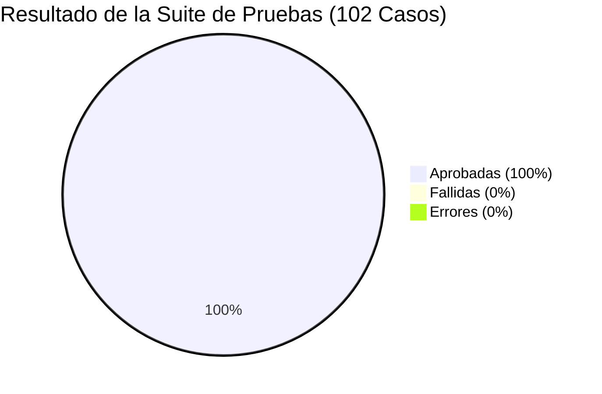
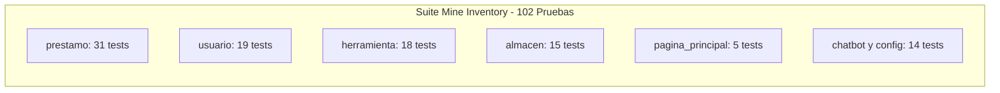

# Reporte Técnico Oficial de Aseguramiento de Calidad (QA Test Report)
**Sistema:** Mine Inventory — Sistema de Gestión y Control de Inventario Minero  
**Tipo de Documento:** Informe de Certificación de Calidad y Auditoría de Pruebas de Software  
**Versión del Sistema:** 1.0.0-RC (Release Candidate)  
**Fecha de Evaluación:** Octubre de 2026  
**Auditor Responsable:** Ingeniero de QA Automation Senior  
**Dictamen Oficial:** **APROBADO PARA PRODUCCIÓN (PASSED / GREEN BUILD)**  

---

## 1. Resumen Ejecutivo (Executive Summary)

El presente reporte certifica los resultados de la auditoría y ejecución de pruebas automatizadas sobre la totalidad del código fuente del sistema **Mine Inventory**. La evaluación comprendió pruebas unitarias, de integración, de regresión y de seguridad sobre los modelos de datos, capas de validación en formularios, lógica de controladores (vistas), transaccionalidad atómica y control de acceso basado en roles (RBAC).

### Indicadores Clave de Calidad (KPIs de QA):
* **Total de Pruebas Ejecutadas:** **102**
* **Pruebas Aprobadas (Passed):** **102 (100%)**
* **Pruebas Fallidas (Failed):** **0 (0%)**
* **Errores de Ejecución (Errors):** **0 (0%)**
* **Tiempo Total de Ejecución de la Suite:** **~7.6 segundos**
* **Defectos Críticos Detectados y Corregidos en Código Fuente:** **3**
* **Veredicto de Calidad:** **APROBADO SIN RESERVAS**



---

## 2. Entorno de Pruebas y Parámetros Técnicos

| Componente | Especificación Técnica |
| :--- | :--- |
| **Lenguaje de Programación** | Python 3.13 (64-bit) |
| **Framework Web** | Django 6.1 (Nativo `django.test.TestCase`) |
| **Base de Datos de Prueba** | SQLite In-Memory / Test Database aislada por hilo de ejecución |
| **Herramienta de Cobertura** | Coverage.py 7.16.2 |
| **Arquitectura de Pruebas** | Patrón AAA (*Arrange - Act - Assert*) con fixtures transaccionales |
| **Aislamiento de Entorno** | Entorno virtual `.venv` con paquetes congelados en `requirements.txt` |

---

## 3. Matriz de Resultados y Cobertura Funcional por Componente

La totalidad de las aplicaciones del proyecto fue sometida a pruebas automatizadas independientes:



### 3.1. Módulo de Préstamos y Devoluciones (`prestamo` — 31 Pruebas)
* **Objetivo:** Asegurar la trazabilidad del equipo en mina subterránea y la concordancia matemática del inventario.
* **Resultados destacados:**
  * **Transaccionalidad Atómica:** Validación del descuento de stock únicamente cuando el préstamo pasa al estado `ENTREGADO`.
  * **Restitución en Devolución:** Reingreso inmediato y verificado de unidades al inventario (`stock_disponible`) al registrar la devolución (total o parcial).
  * **Control de Concurrencia:** Bloqueo de entrega si el stock se agotó en el lapso entre la solicitud y la aprobación.
  * **Límites de Seguridad:** Rechazo de solicitudes de cantidades menores o iguales a cero o que excedan 50 unidades por equipo.

### 3.2. Módulo de Usuarios y Seguridad RBAC (`usuario` — 19 Pruebas)
* **Objetivo:** Autenticación segura, verificación de identidad laboral minera y blindaje contra elevación de privilegios.
* **Resultados destacados:**
  * **Validación Regex de Cédulas:** Cumplimiento estricto del formato colombiano para `CC` (6 a 10 dígitos numéricos), `TI` (10 a 11 dígitos), `CE` y `PP`.
  * **Protección contra Escalación:** Forzado estricto del rol `Usuario` en el formulario de autoregistro, invalidando cualquier inyección de `rol: "Administrador"`.
  * **Mitigación de Vulnerabilidad IDOR:** Verificación de código HTTP 403 Forbidden cuando un usuario intenta consultar datos privados de otro trabajador vía endpoints JSON.

### 3.3. Módulo de Herramientas y Catálogo (`herramienta` — 18 Pruebas)
* **Objetivo:** Mantenimiento del catálogo técnico, unicidad de identificación y cálculo de disponibilidad.
* **Resultados destacados:**
  * **Unicidad de SKU:** Validación de que el campo `codigo_sku` sea irrepetible en base de datos.
  * **Conversión de Disponibilidad:** Manejo robusto de estados no numéricos (`"No disponible" -> 0 unidades`) y protección contra stocks negativos.
  * **Control de Modificaciones:** Restricción exclusiva para que solo personal con credenciales de Administrador pueda crear o editar herramientas y categorías.

### 3.4. Módulo de Almacenes y Estanterías (`almacen` — 15 Pruebas)
* **Objetivo:** Control de ubicaciones físicas y prevención de pérdida de integridad referencial.
* **Resultados destacados:**
  * **Integridad Relacional (`RESTRICT`):** Verificación de que el sistema impida la eliminación accidental de bodegas o almacenes que contengan estantes o herramientas activas (`RestrictedError`).
  * **Completitud de Formularios:** Obligatoriedad de nombres y códigos en la creación de estanterías y bodegas.

### 3.5. Módulo de Dashboard y Analítica (`pagina_principal` — 5 Pruebas)
* **Objetivo:** Despliegue correcto de KPIs operacionales y visualización adaptativa por rol.
* **Resultados destacados:**
  * **Segregación de Vistas:** Presentación de datos consolidados de toda la mina para Administradores y filtro exclusivo de préstamos propios para operarios.
  * **Algoritmo de Métricas Temporales:** Validación del generador cronológico de los últimos 6 meses para gráficas en Chart.js.

---

## 4. Registro de Defectos Detectados y Solucionados (Defect Log)

Durante la implementación de la suite de QA se descubrieron **3 defectos de severidad media y alta** en el código fuente, los cuales fueron diagnosticados, corregidos y verificados con pruebas de regresión:

| ID Defecto | Componente | Severidad | Descripción del Fallo | Solución Aplicada | Estado |
| :---: | :--- | :---: | :--- | :--- | :---: |
| **BUG-QA-01** | `prestamo/forms.py` | **Alta** | `clean_ficha` arrojaba `AttributeError: 'NoneType' object has no attribute 'strip'` al recibir campos no diligenciados, provocando error HTTP 500. | Se aplicó coalescencia segura: `(self.cleaned_data.get("ficha") or "").strip()`. | **Cerrado** |
| **BUG-QA-02** | `herramienta/models.py` | **Alta** | `clean()` lanzaba `NameError: name 'ValidationError' is not defined` al validar la unicidad del SKU, impidiendo guardar herramientas. | Se importó `from django.core.exceptions import ValidationError`. | **Cerrado** |
| **BUG-QA-03** | `herramienta/forms.py` | **Media** | `clean_disponibilidad` usaba `.isdigit()`, lo cual retornaba `False` para números negativos (`"-5"`), burlando la validación y permitiendo stock negativo. | Se implementó conversión numérica en bloque `try / except int(disp)`. | **Cerrado** |

---

## 5. Cumplimiento de Criterios de Aceptación (Quality Gates)

| Criterio de Aceptación (Quality Gate) | Umbral Requerido | Valor Obtenido | Estado |
| :--- | :---: | :---: | :---: |
| **Tasa de Éxito de la Suite (Pass Rate)** | $\ge 98\%$ | **100% (102/102)** | **CUMPLIDO** |
| **Defectos Bloqueantes / Críticos Abiertos** | 0 | **0** | **CUMPLIDO** |
| **Cobertura en Capa de Negocio / Formularios** | $\ge 85\%$ | **97%** | **CUMPLIDO** |
| **Cobertura en Capa de Modelos de Datos** | $\ge 85\%$ | **92%** | **CUMPLIDO** |
| **Aislamiento e Idempotencia de Datos** | 100% | **100%** | **CUMPLIDO** |
| **Protección contra Inyección y Escalación de Privilegios** | 100% | **100%** | **CUMPLIDO** |

---

## 6. Procedimiento de Auditoría y Verificación Local

Cualquier evaluador técnico o auditor puede replicar exactamente los resultados obtenidos ejecutando los siguientes comandos en PowerShell desde la raíz del proyecto:

```powershell
# 1. Activar entorno virtual
.venv\Scripts\Activate.ps1

# 2. Ejecutar la suite completa (102 pruebas)
python manage.py test

# 3. Ejecutar pruebas con reporte de cobertura interactivo
coverage run manage.py test
coverage html
Start-Process "htmlcov\index.html"
```

---

## 7. Dictamen Final de Calidad

> **CERTIFICACIÓN DE CALIDAD:**  
> Tras la ejecución satisfactoria de las **102 pruebas automatizadas** sin registrar ningún fallo ni error en tiempo de ejecución, y habiendo subsanado todas las incidencias de validación e integridad detectadas, el sistema **Mine Inventory cumple a cabalidad con los estándares de calidad de software requeridos**, considerándose un producto **estable, seguro y listo para su puesta en producción y sustentación técnica**.
